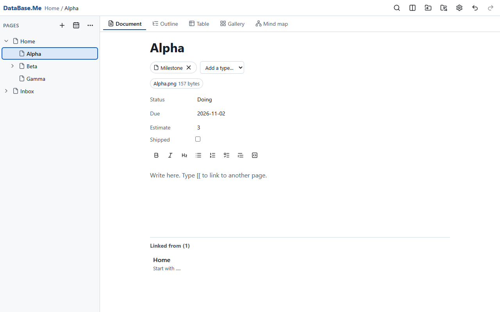
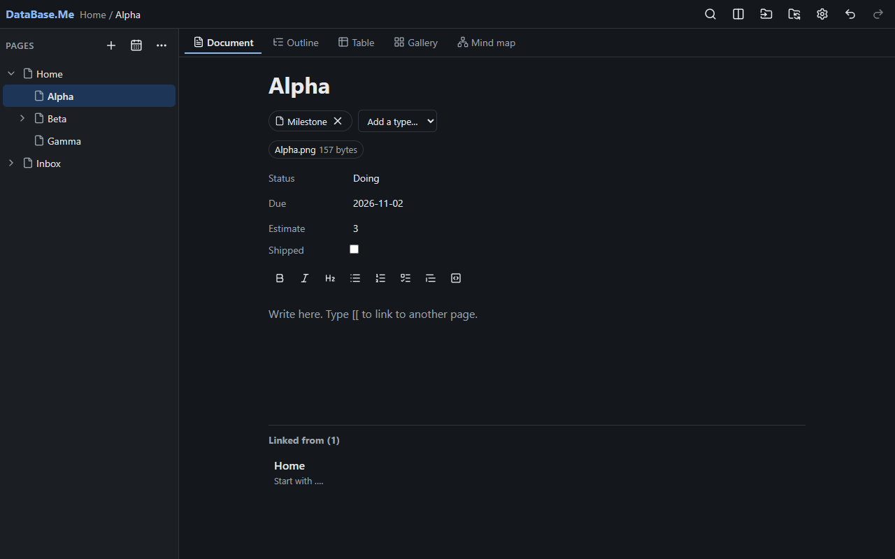
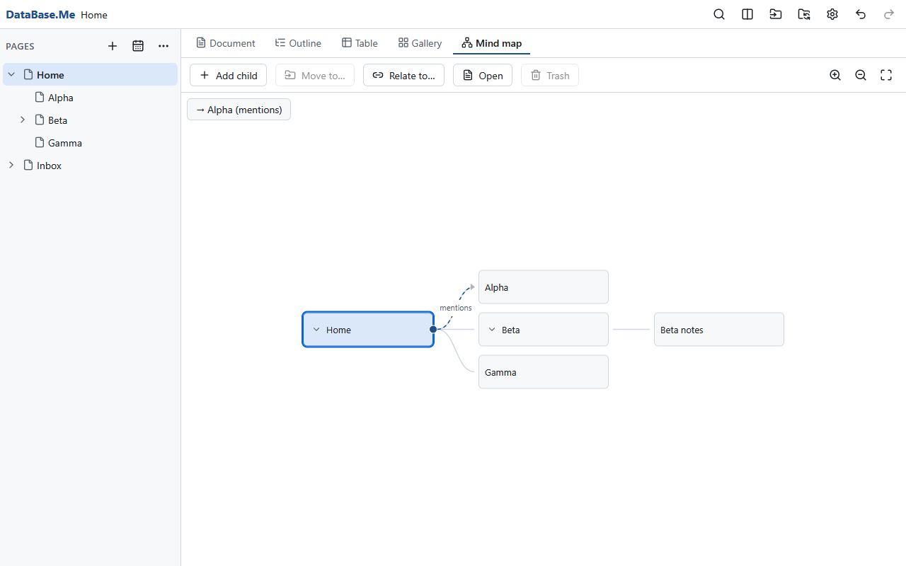
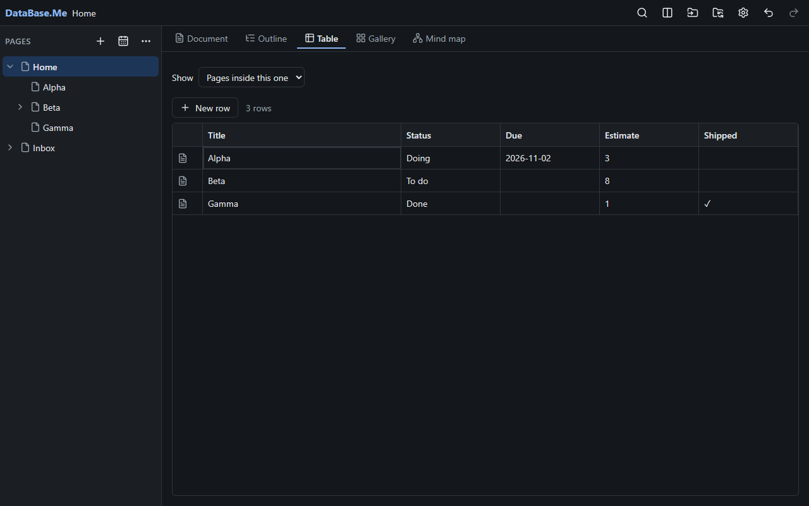
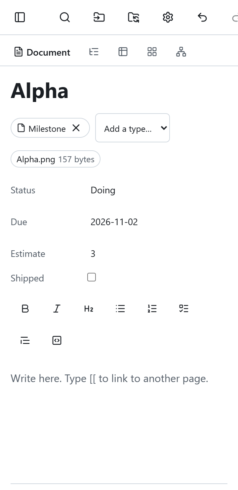
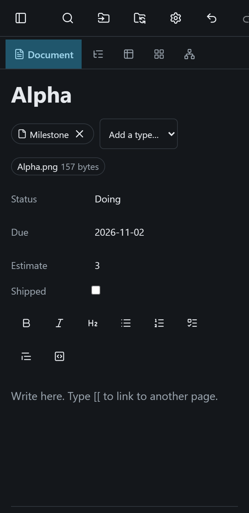

# DataBase.Me

A free, open-source, local-first **lifetime information repository**: a mind map on steroids.

Capture anything: notes, documents, spreadsheets, PDFs, images, web pages, email, audio, calendars,
contacts and whole archives. Organise it with structure you build yourself, find it instantly, and
look at the same information as a document, an outline, a mind map, a table, a canvas, a graph, a
timeline, a map or a chart. Every object is also a plain Markdown file you can edit in any tool,
and your edits flow back into the app.

> **Status: 0.1, the MVP (milestone M7).** Pages with a block editor; Document, Outline, Mind
> map, Table and Gallery views; search and saved views; a two-way Markdown files folder that
> opens in Obsidian; importing of Markdown folders, CSV, Excel, PDF and pictures; export; Simple
> and Organizer modes; light and dark themes; installers for Windows, macOS and Linux. Progress is
> tracked milestone by milestone in [docs/milestones/](docs/milestones/); the full plan is in
> [DataBase.Me_Build_Plan.md](DataBase.Me_Build_Plan.md). Canvas, graph, timeline, map and chart
> views, encryption, plugins, AI and sync are later milestones.

## What it promises

- **Your data, your disk, forever.** One SQLite file, a folder of content-addressed files and a
  two-way folder of Markdown files, all documented in [docs/FORMAT.md](docs/FORMAT.md). It works
  offline, and full export is one click.
- **No strings.** No account, no telemetry, no crash reporter, no analytics, no paid tiers and no
  hosted service. The app makes no network request unless you turn on a feature that needs one;
  even update checks are opt-in.
- **AI is optional and off by default.** When you turn it on, you choose the provider (including
  ones on your own computer or network), per-space permissions apply, and every call is logged.
- **Sandboxed plugins.** Plugins get only the access you grant them.
- **For everyone.** Simple mode feels like a plain notes app; more power appears when you want it.
  Accessible (WCAG 2.2 AA) and built for phones as well as desktops.

## Install

Download the installer for your system from the
[releases page](https://github.com/custodia-secured/DataBase.Me/releases): `DataBase.Me_<version>_x64-setup.exe`
or the `.msi` for Windows, `DataBase.Me_<version>_aarch64.dmg` (Apple Silicon) or `_x64.dmg`
(Intel) for macOS, and the `.AppImage`, `.deb` or `.rpm` for Linux. Every release carries a
`SHA256SUMS.txt` to check a download against. The
[getting started](docs/user-guide/getting-started.md) page walks through the first launch, and
says what each system warns about an installer that is not yet signed and how to proceed.

The app makes no network request: there is nothing to sign up for, and nothing phones home. The
[privacy](docs/user-guide/privacy.md) page says how that is tested on every change, and how to
check it on your own machine.

## Screenshots

|                                  Light                                   |                                  Dark                                  |
| :----------------------------------------------------------------------: | :--------------------------------------------------------------------: |
|  |  |
|        |        |
|           |           |

## Documentation

The [user guide](docs/index.md) covers installing, the first ten minutes, the vault, pages and
views, the files folder and Obsidian, importing, settings, keyboard and accessibility, privacy and
how to report a problem. [FORMAT.md](docs/FORMAT.md) documents every byte the app writes, so a
vault can be read without it.

## Build from source

You need:

- [Rust](https://rustup.rs) via rustup. The exact version is pinned in `rust-toolchain.toml` and
  rustup installs it on first use.
- [Node.js](https://nodejs.org) 22.13 or newer, with pnpm through Corepack (`corepack enable`, or
  prefix the commands below with `corepack`).
- The [Tauri 2 prerequisites](https://v2.tauri.app/start/prerequisites/) for your OS: the
  Microsoft C++ Build Tools and WebView2 on Windows, Xcode Command Line Tools on macOS, and
  WebKitGTK 4.1 on Linux.

```sh
pnpm install
pnpm dev                     # run the desktop app with hot reload
pnpm test && cargo test --workspace
pnpm --filter @databaseme/desktop tauri build   # build an installer for your OS
```

[CONTRIBUTING.md](CONTRIBUTING.md) lists every check CI runs.

## Repository layout

| Path            | What it holds                                                     |
| --------------- | ----------------------------------------------------------------- |
| `apps/desktop/` | The Tauri 2 desktop app: Rust shell in `src-tauri/`, web UI       |
| `crates/core/`  | Domain model: objects, types, relations, op log, query DSL        |
| `crates/cli/`   | The `dbme` command-line tool                                      |
| `packages/ui/`  | Design system: tokens, theming, shared components                 |
| `packages/sdk/` | Plugin SDK (Apache-2.0)                                           |
| `docs/`         | FORMAT.md, ARCHITECTURE.md, decision records (`adr/`), milestones |
| `fixtures/`     | Sample vaults and test files, including deliberately broken ones  |
| `scripts/`      | CI helpers: DCO check, licence check, launch test                 |

The other crates (`store`, `api`, `mirror`, `export`, `ingest`, `e2e-server`) and packages
(`client`, `views`) are described in [docs/ARCHITECTURE.md](docs/ARCHITECTURE.md), which has the
whole map; later milestones add more.

## Contributing

Contributions are welcome. Every commit needs a `Signed-off-by:` line under the
[Developer Certificate of Origin](https://developercertificate.org); there is no CLA. See
[CONTRIBUTING.md](CONTRIBUTING.md), [GOVERNANCE.md](GOVERNANCE.md) and the
[Code of Conduct](CODE_OF_CONDUCT.md). Report security problems privately, as
[SECURITY.md](SECURITY.md) describes.

## Licence

The app is licensed under the [GNU Affero General Public License v3.0 or later](LICENSE). The
plugin SDK (`packages/sdk/`) and the file-format specification (`docs/FORMAT.md`) are licensed
under the [Apache License 2.0](packages/sdk/LICENSE), so anyone can write plugins and readers for
DataBase.Me files. [ADR-0004](docs/adr/0004-licensing.md) explains why.

## Funding

DataBase.Me is funded by voluntary support only: no paid tiers, no hosted service, no investors.
If it is useful to you, you can
**[support DataBase.Me](https://buy.stripe.com/9B65kC5Z7c5j82udqCdUY00)** with a one-time payment
of any amount from 2 USD.

Payments go to Belmaix Holdings LLC through Stripe. They are not charitable donations and are not
tax-deductible, and they buy nothing: no features, no priority, no say over the roadmap
([GOVERNANCE.md](GOVERNANCE.md), [ADR-0011](docs/adr/0011-funding-through-stripe.md)).
